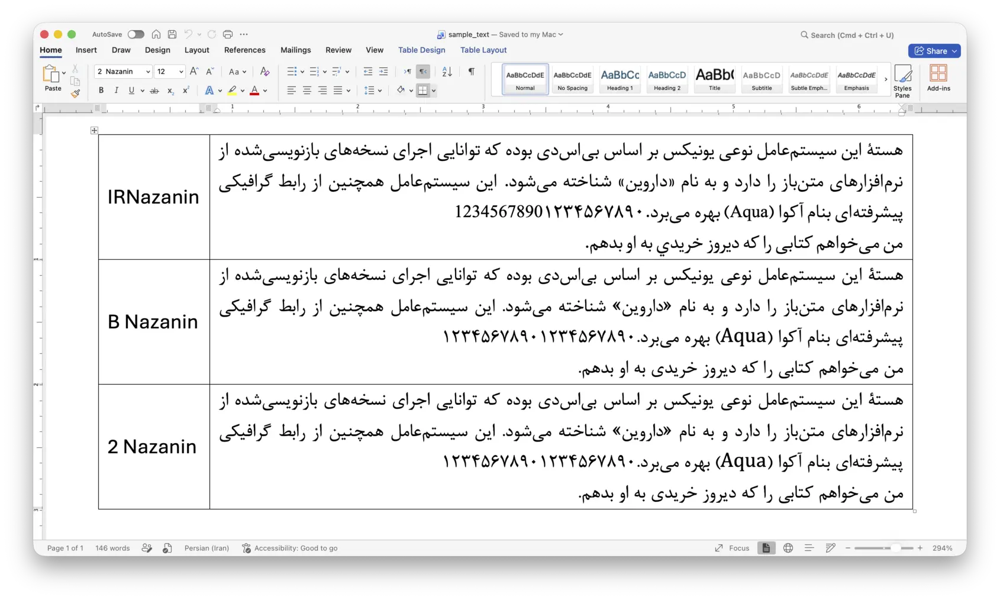

# Fixed Persian Fonts

Most free Persian fonts do not fully comply with the TrueType/OpenType standards. Consequently, they may not display correctly in Microsoft Office for Mac, leading to inconsistencies when a document is viewed on Windows and Mac. This repository resolves these issues by fixing Persian fonts to ensure consistent rendering across both platforms. Before copying the corrected fonts, make sure to completely remove any existing versions of the old fonts (see [Installation](#installation)).

**Note:** This repo doesn't aim to fix other issues that these fonts have.

The following screenshot shows the use of fixed fonts in Microsoft Word 2024 running on MacOS 15.


## Fonts

| Folder | Family | Fonts |
|---|---|---|
| `B fonts/` | B fonts (Borna Rayaneh), e.g. B Nazanin, B Lotus, B Titr, B Zar, B Mitra | 120 |
| `IRfonts/` | IR fonts, e.g. IRNazanin, IRLotus, IRBadr, IRZar, IRYekan | 60 |
| `2 fonts/` | "2" fonts (B fonts under "2 …" family names), e.g. 2 Nazanin, 2 Titr | 45 |

## What is fixed

A document now renders the same in Word for Windows and Word for Mac:

- **Line spacing:** every font now gives the same line spacing on Mac as on Windows. In the originals, Mac lines were either cramped (as little as 1.00 em, with a shifted baseline) or too loose.
- **Fonts and styles:** Mac and Windows see the same names, character maps and bold/italic flags. For example, IRLotus Bold now belongs to the IRLotus family on Mac too, and B Kaj/Sahar/Zaman are Italic on both platforms.
- **Persian text works on Mac as on Windows:**
  - نیم‌فاصله (ZWNJ) and the invisible direction marks no longer leave gaps or marks.
  - لا always joins.
  - Option+Space (no-break space) stays in the same font.
  - Letters are no longer pulled apart by broken kerning: the «زندان» problem in IRLotus, IRBadr-Bold, IRMaryam and IRTerafik is fixed.
- **Justify Low / Medium / High** (Word's kashida justification) stretches words cleanly, without flattened letters or square blocks sticking out of joins. Kashidas you type yourself (ـ) look exactly as before.

See [CHANGELOG.md](./CHANGELOG.md) for the full list of changes relative to the original fonts.

## Compatibility with existing documents

- **PostScript names are unchanged**, so documents created with the original fonts (Word, Pages, Keynote) still find them.
- **Family names are unchanged**, except IRLotus Bold, whose family was `IRlotus` (lowercase l). Windows already treated it as IRLotus.
- **Glyph shapes are unchanged.** Spacing and line breaks match the original fonts on Windows. The exception is justified text, where the kashidas are now drawn cleanly.
- **Three files were renamed** to match the fonts inside: `B Elm Bold.ttf` → `B Elm Border.ttf`, `B Niki Bold.ttf` → `B Niki Border.ttf`, `IRlotus-Bold.ttf` → `IRLotus-Bold.ttf`. (The first two contain the regular "Border" fonts, not bold ones.)

## Installation

### macOS
1. Open **Font Book** and remove every existing copy of these fonts (select them → File → Remove). Check both "User" and "Computer" fonts.
2. Quit Word and the other Office apps.
3. Double-click the new `.ttf` files and click **Install**, or drag them into Font Book.
4. If old shapes or spacing still appear, clear the font cache, then log out and back in:
   ```
   sudo atsutil databases -remove
   ```

### Windows
1. Open **Settings → Personalization → Fonts** and uninstall the existing versions (including any installed "for all users").
2. Close Word.
3. Select the new `.ttf` files, right-click and choose **Install for all users**.

## How the fonts were checked

- All fonts pass the [OpenType Sanitizer](https://github.com/khaledhosny/ots-python), the font validation used by web browsers.
- Persian test text is shaped with HarfBuzz and compared glyph by glyph with the original fonts.
- An automated test of 3,872 letter combinations per font checks that no kerning pair detaches a letter from its word.
- The platform-specific tables (line metrics, names, character maps, style flags) are checked to agree between Windows and Mac in every font.

## Known limitations

These come from the original font designs and are intentionally unchanged:

- In the B and "2" fonts, Latin digits 0–9 show Persian digit shapes, and ی/ي and ک/ك share glyphs.
- The B and "2" fonts have no glyphs for hamza above (ٔ), superscript alef (ٰ), the ellipsis (…) or the euro sign (€); these appear in a fallback font.
- The "2" fonts keep their original family names with two spaces (for example "2  Nazanin"), because documents store these names.
- B Badkonak, B Kidnap, B Masjed, B Moj and B Tanab have ornamental kashidas that can't be stretched cleanly, so justified text in these fonts behaves as in the originals.
- Windows applies the fonts' hinting on screen at small sizes. This changes only pixel snapping on screen, not layout or printing.
